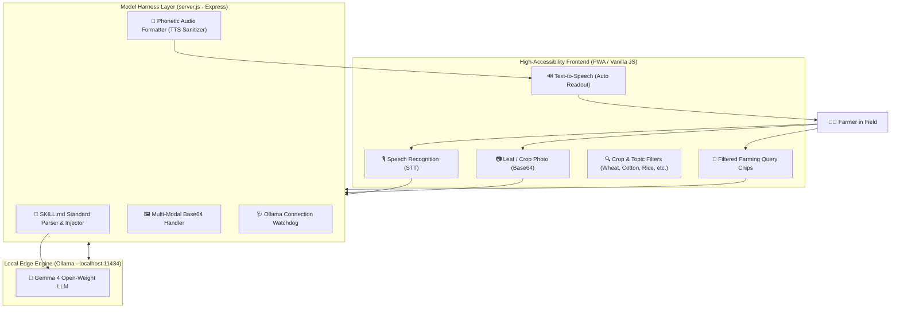

# 🌾 KisaanDost AI (کسان دوست)
### *"Har Kisan Ka Smart Digital Sathi"*

[](https://hacktoberfest.com/)
[](./SKILL.md)
[](https://ollama.com/)
[](./LICENSE)

---

## 📌 1. Project Overview & Target Audience

**KisaanDost AI** is an open-source, edge-first, and voice-assisted agricultural intelligence platform engineered for **Hacktoberfest 2026**.

In South Asia and emerging agricultural belts, millions of smallholder farmers are non-literate or semi-literate. When crops suffer from leaf curl virus, fungal rust, or insect attacks, traditional English or text-heavy apps fail them. 

**KisaanDost AI** removes literacy and technical barriers by providing:
1. **🔍 Crop & Agricultural Topic Filtering**: Instant one-tap categorization for **Wheat, Cotton, Rice, Vegetables, Fertilizers, and Cattle/Dairy**.
2. **👨‍🌾 Farmer Imagery & Visual Interface**: High-contrast, sunlight-readable agricultural theme featuring real farmer imagery and authentic farm visual cues.
3. **💬 Simple English & Voice-First Interaction**: Simple English UI text and conversational guidance with Web Speech API (STT & TTS) readout.
4. **📷 Camera & Image Analysis**: Take a photo of diseased leaves or pests directly from the field for diagnostic guidance.
5. **🧠 Local Privacy-First AI**: Runs open-weight **Gemma 4** locally via **Ollama**, ensuring offline availability and zero subscription costs for rural farmers.
6. **📜 Agent Skill Open Standard (`SKILL.md`)**: Strictly guided by agricultural domain safety boundaries and chemical precautions.

---

## 🏛️ 2. System Architecture



---

## 🛠️ 3. Tech Stack

- **AI Engine**: Google Gemma 4 hosted locally via [Ollama](https://ollama.com).
- **Backend Model Harness**: Node.js & Express.js with `js-yaml` parser.
- **Frontend**: Accessible HTML5, CSS3, Vanilla JavaScript with Web Speech API (`SpeechRecognition` & `SpeechSynthesis`).
- **Standard**: Agent Skill Open Standard Specification (`/SKILL.md`).
- **No Login / Frictionless Access**: Farmers can open the web app and immediately speak or take a picture.

---

## 🚀 4. Step-by-Step Installation & Setup

### Prerequisites
1. **Node.js**: v18.0.0 or higher ([Download Node.js](https://nodejs.org/))
2. **Ollama**: Local AI runner ([Download Ollama](https://ollama.com/download))

---

### Step 1: Install & Launch Ollama with Gemma 4

Open your terminal or command prompt and run:

```bash
# Verify Ollama is installed
ollama --version

# Pull and run Google Gemma 4
ollama run gemma4
```

> **Note**: Keep this terminal window open or ensure the Ollama background daemon is running (`http://localhost:11434`).

---

### Step 2: Clone the Repository & Install Dependencies

```bash
# Clone the repository
git clone https://github.com/your-username/kisaandost-ai.git

# Enter project directory
cd kisaandost-ai

# Install backend dependencies
npm install
```

---

### Step 3: Start the Backend Model Harness

```bash
# Start the production server
npm start
```

*For live auto-reloading during development:*
```bash
npm run dev
```

The terminal will confirm:
```text
====================================================
🌾 KisaanDost AI - Model Harness Server
====================================================
🚀 Web Interface : http://localhost:3000
🤖 Ollama Target : http://localhost:11434 (gemma4)
📜 Agent Skill   : .../SKILL.md
💡 Mode          : High Accessibility / Voice & Image First
====================================================
```

---

### Step 4: Open the Application

Open your browser and navigate to:
```
http://localhost:3000
```

1. Check the top-right status pill: It will display **"● GEMMA 4 Active"** in green.
2. Tap the **🎙️ Bolein (Mic)** button to ask a question in Roman Urdu (e.g., *"Gandum ke pattay peelay kyun par rahay hain?"*).
3. Tap the **📷 Photo** button to snap or upload a crop leaf image for diagnosis.
4. Listen as KisaanDost AI automatically reads out the diagnosis and treatment!

---

## 📜 5. Agent Skill Open Standard (`SKILL.md`)

This repository strictly adheres to the **Agent Skill Open Standard**. Located at `/SKILL.md`, it specifies:
- **Identity & Persona**: Senior Agricultural Extension Specialist (Zaree Mahir) who speaks respectful, humble Roman Urdu.
- **Agricultural Scope**: Field crops (Wheat, Cotton, Rice, Sugarcane, Maize), vegetables, orchards, fertilizers (Urea, DAP, SOP), and livestock basics.
- **Safety Boundaries & Guardrails**:
  - Always enforce protective gear (mask/cloth) when handling pesticides.
  - Advise against spraying in high winds or rain.
  - Politely reject non-farming questions (politics, entertainment, coding).
- **JSON Input / Output Contracts**: Standardized parameter passing for agent orchestration.

---

## 🔌 6. API Reference

### 1. `POST /api/chat`
Dispatches farmer prompt and image to Ollama with injected `SKILL.md` context.

**Request Body:**
```json
{
  "prompt": "Kapas par safaid makhi ka hamla hai, kya karoon?",
  "image": "data:image/jpeg;base64,...",
  "history": [
    { "role": "user", "content": "Aoa" },
    { "role": "assistant", "content": "Walaikum Assalam bhai jaan..." }
  ]
}
```

**Response:**
```json
{
  "status": "success",
  "reply": "**Diagnosis:** Kapas par safaid makhi...\n- Shaam ke waqt spray karein.\n- Mask pehanna zaroori hai.",
  "audioSuggested": "Aoa pyare kisaan bhai. Kapas par safaid makhi ke liye shaam ke waqt spray karein.",
  "model": "gemma4",
  "timestamp": "2026-10-23T14:00:00.000Z"
}
```

### 2. `GET /api/health`
Checks connection health to local Ollama instance and verifies `gemma4` model readiness.

### 3. `GET /api/skill`
Returns parsed metadata and instructions from `SKILL.md`.

---

## 🎃 7. Hacktoberfest 2026 Contribution Guide

We welcome contributions from developers, agronomists, and designers worldwide!

### Great First Issues to Pick Up:
- [ ] Add offline caching via Service Worker (Full PWA support).
- [ ] Add audio recording fallback for browsers lacking Web Speech API.
- [ ] Expand localized disease datasets in `SKILL.md` (e.g. Rice Blast, Citrus Canker).
- [ ] Add Punjabi / Sindhi / Pashto phonetic dialect packs.

### Contribution Steps:
1. Fork the repo and create your branch: `git checkout -b feature/amazing-feature`.
2. Ensure your changes respect the `SKILL.md` safety boundaries.
3. Test locally with `npm start` and `ollama run gemma4`.
4. Commit your changes: `git commit -m 'feat: Add audio caching support'`.
5. Push to your branch: `git push origin feature/amazing-feature`.
6. Open a Pull Request tagged with **`hacktoberfest`**.

---

## 📄 8. License

Distributed under the **MIT License**. See [`LICENSE`](./LICENSE) for full details.

Developed with ❤️ for farmers worldwide. *Kisaan khushhal, to mulk khushhal!* 🌾
